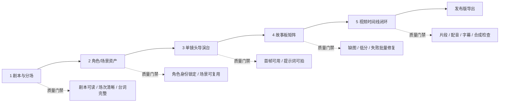

# 项目生产台 V2 信息架构与页面改版实施清单

日期：2026-07-06

## 0. 设计 brief

目标：把当前项目生产台升级为面向 AI 漫剧/短剧生产的五段式专业工作台，从剧本分场到角色/场景资产、单镜头精修、故事板矩阵、视频时间线和导出形成闭环。

视觉方向：沿用当前前台深色生产型 SaaS 框架，保持左侧全局导航、顶部搜索/积分/模型状态；内容区改为更像“创作生产 cockpit”的密集工作台。避免营销页、装饰性大卡片和过度留白。

交互级别：下一步前端实现应做完整交互。Tabs、筛选、选择镜头、批量操作、编辑表单、预览弹窗、任务状态、质检入口、导出按钮都要可操作，优先复用现有 API 和本地状态。

## 1. 核心结论

项目生产台 V2 不选单一界面，而是采用三层生产结构：

1. 单个资产精修：角色图、场景卡、单镜头首帧、单镜头提示词都能精细调整。
2. 批量全局查看：故事板矩阵用于按集、场次、镜头批量查看、筛选、重生、质检。
3. 成片闭环制作：视频时间线把图生视频、配音、字幕、音效、合成和导出收束到最终发布版。

故事板矩阵的主流程不是“先生成一张大故事板图再裁剪”。主流程应该是每个镜头独立生成图片资产，再由前端矩阵拼装展示。这样才能支持单镜头重生、版本管理、角色一致性、图生视频和质量评测。可以保留“快速草稿模式”：AI 生成 contact sheet 或故事板总览图，再裁切成草稿镜头，但它只能作为早期视觉探索，不作为最终生产资产。

## 2. 市场工作流学习与融合

参考对象：

- ComfyUI：学习它的工作流、节点、队列、可复用 recipe 思路，但不把节点复杂度直接暴露给普通创作者。前台只显示“剧本分场、角色资产、单镜头、矩阵、时间线”，底层可以把生成链路抽象成生产 recipe。
- LiblibAI/类似模型与工作流平台：学习模型、工作流、参考图、LoRA/风格资产复用，但本项目不做泛模型广场，差异化放在“项目级短剧生产管理”和“镜头级闭环”。
- LTX Studio、Runway、Adobe Firefly Storyboard 类产品：学习从故事板到视频、角色/场景一致性、镜头预览、视频导出的连续体验。

差异化定位：

本项目不是单点生图工具，也不是普通视频生成工具，而是“短剧项目生产台”。优势应该体现在：

- 每个镜头都有结构化字段：场次、景别、角色、动作、台词、音频、图片提示词、视频提示词、资产引用。
- 角色、场景和分镜互相关联，而不是每次提示词重新发明。
- 单镜头可精修，批量矩阵可扫片，总时间线可发布。
- 所有生成都进入任务、积分、质量和反馈闭环。

## 3. V2 信息架构



全局页面骨架：

- 顶部项目条：项目名、剧情一句话、比例、风格、当前模型路由、积分预估、刷新、导出。
- 阶段进度条：剧本与分场、角色/场景、单镜头导演台、故事板矩阵、视频闭环。
- 生产控制条：下一步主操作、当前任务、预估积分、失败/重试提示。
- 主工作区：随当前阶段切换，不再把所有信息塞进同一块面板。
- 右侧可选检查器：质量分、任务记录、模型参数、AI 建议、用户反馈。

## 4. 页面 1：剧本与分场工作台

现状问题：当前 UI 已经有“前置检查、剧情梗概、角色候选、场景候选”，但仍偏确认页，缺少真正的剧本生产能力。用户需要在这里完成“读懂剧本、拆场次、锁节拍、准备分镜”。

V2 目标：把剧本页升级为“编剧与分场工作台”，成为后续角色、分镜、图片、视频的上游数据源。

推荐布局：

- 左栏：集数/场次导航。显示第几集、第几场、地点、时间、状态、镜头数预估。
- 中栏：剧本文本与分场编辑器。支持按场次查看原文、动作、台词、旁白、情绪节拍。
- 右栏：分场检查器。显示角色出场、场景锚点、节奏钩子、风险提示、可拆镜建议。
- 底部：分镜前预检条。提示“角色卡是否齐、场景是否归档、台词是否完整、是否可生成分镜表”。

关键模块：

- 剧情梗概：一句话梗概、每集目标、情绪曲线、结尾钩子。
- 分场列表：场次名、地点、时间、出场角色、冲突目标、重点动作、预计时长。
- 剧本文本编辑：正文预览、按场次折叠、台词/旁白高亮。
- 角色抽取：角色候选、身份、出场次数、是否已生成角色卡。
- 场景抽取：场景候选、空间锚点、光线、道具、可否生成场景卡。
- 分镜生成前检查：台词零删改、长台词拆镜、场内人物连续性、场次转场承接。

核心操作：

- 重新解析剧本
- 拆分/合并场次
- 锁定场次
- 生成角色卡
- 生成/刷新分镜表
- 导出剧本与分场草稿

前端状态：

- 空状态：等待剧本生成。
- 草稿状态：剧本已生成，但场次未确认。
- 可生产状态：场次、角色、场景候选已确认，可生成分镜。
- 风险状态：台词过长、场景缺失、角色未归档、分镜表已经存在但剧本被改动。

## 5. 页面 2：角色/场景资产工作台

目标：锁定后续分镜图和视频的一致性，不让分镜提示词反复重新发明角色外貌和场景。

推荐布局：

- 左侧：角色身份板列表，含主角、配角、群众角色。
- 中央：当前角色大预览，支持三视图、用户上传参考、衍生姿态。
- 右侧：一致性检查器，显示外貌锚点、服装锚点、负面提示词、seed、引用次数。
- 下方：场景卡横向列表，展示地点、时间、光线、关键道具、引用镜头数。

关键操作：

- 上传角色参考图
- 生成角色身份板
- 生成衍生表情/动作/服装
- 设为主参考
- 清空参考
- 生成场景卡
- 角色/场景质量评测

质量门槛：

- 主要角色未锁定时，不建议批量生成分镜图。
- 角色质量分低于 80 时，只允许单镜头测试，不允许全量批量。
- 场景卡缺失时，分镜图提示词需要明显提示“场景未锁定”。

## 6. 页面 3：单镜头导演台

目标：服务用户说的“单个图或者分镜肯定要精修”。这是精修效率和最终质量的核心页面。

推荐布局：

- 左栏：镜头列表。按场次分组，显示镜头号、首帧状态、视频状态、质量分。
- 中央：当前镜头画布。大图预览、空状态、当前版本、对比预览。
- 右栏：镜头检查器。基础字段、角色/场景引用、图片提示词、视频提示词、生成参数。
- 底部：版本带。显示该镜头历史图片、视频草稿、用户选择的最终版。

关键字段：

- 时长、景别、机位、运镜
- 出场角色、场景、道具
- 动作、朝向、站位、情绪
- 台词、旁白、环境音、音效
- 图片提示词、视频提示词、负面提示词
- 引用资产 ID、seed、模型参数

关键操作：

- 保存镜头字段
- 单镜头生成首帧
- 强制重绘
- 生成 2 到 4 个候选
- 设为最终首帧
- 复制上一镜头风格
- 生成单镜头视频
- 提交创作者反馈
- 运行当前镜头质检

## 7. 页面 4：故事板矩阵

目标：整体批量查看，不替代单镜头精修。它是“扫片、补齐、筛选、批量重生”的工作台。

推荐布局：

- 顶部筛选条：全部、缺首帧、低分、生成失败、未锁定角色、待视频、已完成。
- 左侧场次索引：按集/场快速定位。
- 中央矩阵：镜头缩略图网格，卡片展示镜头号、角色、状态、质量分、视频状态。
- 右侧批量操作栏：选中数量、预估积分、批量重生、批量质检、生成视频、导出故事板。

矩阵卡片信息：

- 首帧缩略图或待生成状态
- 第几集/第几场/镜头号
- 角色头像小标、场景名
- 图片状态、视频状态、质量分
- 快捷操作：预览、进入导演台、重生、设为最终版

关于“大图裁剪”：

- 主流程：shot-level asset first。每个镜头独立生成、独立版本、独立质检。
- 可选草稿：contact sheet draft。先生成 3x3 或 5x5 故事板总览图，用于快速看构图节奏，再裁切为草稿缩略图。
- 草稿切片不能直接进入视频生成，必须被用户确认或单镜头重绘后才可作为正式首帧。

## 8. 页面 5：视频时间线闭环

目标：把最后“视频生成到导出”做成总闭环工作台。

推荐布局：

- 上方：成片预览播放器，显示当前合成状态。
- 中间：时间线轨道。视频轨、配音轨、字幕轨、音效轨。
- 左侧：镜头片段列表，按分镜顺序显示生成状态。
- 右侧：导出检查器。缺片段、缺配音、缺字幕、比例、码率、封面、导出格式。
- 底部：导出任务与历史版本。

关键操作：

- 批量生成镜头视频
- 单镜头视频重生
- 生成配音
- 生成字幕
- 编辑字幕
- 生成音效建议
- 合成 MP4
- 下载发布版
- 导出工程包/分镜表

质量门槛：

- 无首帧的镜头不能进入图生视频。
- 视频缺失时，时间线显示断点。
- 配音和字幕可以独立生成，但发布版导出前必须提醒缺失项。

## 9. 数据对象与 API 支撑

现有可复用对象：

- `ScriptDraft`：剧本文本、梗概、版本。
- `CharacterProfile`：角色卡、身份、外貌、服装、提示词、seed。
- `StoryboardShot`：镜头字段、图片提示词、视频提示词、引用资产。
- `AssetItem`：角色、场景、图片、视频、音频、字幕资产。
- `ExportJob`：TTS、字幕、MP4 导出任务。
- `QualityReport` 与 `UserFeedback`：质量评测和用户反馈。

建议新增或前端先模拟的对象：

- `SceneBreakdown`：从剧本拆出的场次结构。短期可从 `StoryboardShot.scene` 聚合推导，长期应入库。
- `ShotVersion`：同一镜头的多张图片、多条视频候选。短期可用同类型 `AssetItem` 加命名约定，长期应建立版本关系。
- `TimelineClip`：视频时间线片段。短期从 `StoryboardShot + video AssetItem` 推导，长期支持剪辑偏移、转场、音轨。
- `AssetLockState`：角色、场景是否锁定。短期可用 `status/referenceUrl` 推导，长期加入显式字段。

当前可直接复用 API：

- `api.workflow(projectId)`
- `api.generateStoryboards(projectId, input)`
- `api.updateStoryboardShot(projectId, shotId, input)`
- `api.generateCharacterImages(projectId, input)`
- `api.generateImages(projectId, input)`
- `api.regenerateShotImage(projectId, shotId)`
- `api.generateVideos(projectId)`
- `api.generateQualityReports(projectId, input)`
- `api.submitFeedback(input)`
- `api.createExportJob(projectId, { type })`
- `api.exportStoryboard(projectId)`
- `api.storyboardProductionPackage(projectId)`

后续建议补 API：

- `PATCH /projects/:id/script`
- `POST /projects/:id/script/scene-breakdown`
- `PATCH /projects/:id/scenes/:sceneId`
- `POST /projects/:id/scenes/:sceneId/split`
- `POST /projects/:id/scenes/:sceneId/merge`
- `GET /projects/:id/storyboards/:shotId/versions`
- `POST /projects/:id/storyboards/:shotId/image/variants`
- `POST /projects/:id/storyboards/:shotId/video/regenerate`

## 10. 前端实施清单

### P0：先做纯前端重排，最大化复用现有 API

1. 重命名项目生产台 tabs：
   - 剧本与分场
   - 角色/场景
   - 单镜头导演台
   - 故事板矩阵
   - 视频闭环

2. 改造 `ScriptBoard` 为剧本与分场工作台：
   - 左侧场次导航
   - 中间剧本文本/分场预览
   - 右侧角色候选、场景候选、分镜前检查
   - 顶部状态从“确认页”升级为“可生产检查”

3. 拆分现有 `CreatorImagesBoard`：
   - `ShotDirectorBoard`：单镜头导演台，保留当前单镜头预览、编辑、单张生成、反馈。
   - `StoryboardMatrixBoard`：新建矩阵视图，从 `storyboards + imageAssets + videoAssets + qualityReports` 拼装。

4. 保留并升级 `CreatorCharacterBoard`：
   - 角色卡压缩成更像资产库的网格。
   - 场景卡从右侧附属模块升级成可扫视列表。
   - 明确“锁定/未锁定/低分”的视觉状态。

5. 升级 `VideoBoard`：
   - 从卡片网格改成视频时间线结构。
   - 保留生成配音、字幕、MP4 的现有按钮。
   - 增加导出检查器和缺失项提示。

6. 更新 `styles.css`：
   - 统一 V2 class 前缀，如 `project-v2-*`。
   - 减少大卡片嵌套，改为工作区、列表、检查器三栏。
   - 卡片圆角不超过 8px，按钮和状态 pill 保持紧凑。
   - 移动端降级为单列堆叠，但保持镜头卡片固定比例。

### P1：补齐编辑和版本能力

1. 剧本与分场支持保存改动。
2. 场次拆分独立入库。
3. 单镜头支持多候选图版本。
4. 单镜头支持选择最终首帧。
5. 矩阵批量操作支持按筛选结果提交。

### P2：加入高级生产能力

1. 快速草稿模式：生成故事板 contact sheet 并切片为草稿。
2. 角色衍生资产：表情、动作、换装。
3. 场景概念图生成。
4. 单镜头图生视频重生。
5. 分镜/图片/视频质量门禁可配置。

### P3：形成专业闭环

1. 时间线字幕编辑。
2. 多轨音频。
3. 封面生成。
4. 发布平台预设。
5. 工程包导出。
6. ComfyUI/自定义工作流 recipe 高级模式。

## 11. 验收标准

前端完成后，至少满足：

- 用户能从剧本页理解项目是否可以进入分镜。
- 用户能先锁定角色/场景，再生成分镜图。
- 用户能对单个镜头精修图片和提示词。
- 用户能在矩阵里快速找出缺图、失败、低分镜头并批量处理。
- 用户能进入视频闭环页生成视频、配音、字幕并合成 MP4。
- 所有关键按钮都有禁用态、加载态、成功态、失败态。
- 没有文字溢出、按钮挤压、卡片套卡片、无意义装饰背景。

## 12. 效果图生成提示词

用于 Product Design 先生成三张拆解效果图，尺寸统一 1440 x 1024。

### 效果图 1：剧本与分场工作台

```text
Create a realistic production-quality desktop SaaS UI, 1440 x 1024.

Product: Chinese AI manga short-drama production studio. Screen: "剧本与分场工作台".

Use a dark professional production-console visual style matching an existing Chinese SaaS app: left global sidebar, top search/model/credits bar, dense but readable workspace, compact controls, no marketing hero, no decorative blobs.

Layout:
- Project title and five-step progress at top.
- Main content is a three-column script planning cockpit.
- Left column: episode and scene navigator with scene status, location, time, estimated duration.
- Center column: script and scene editor, showing synopsis, scene cards, highlighted dialogue, action, voice-over, beat/hook.
- Right column: preflight inspector with character candidates, scene candidates, continuity risks, "生成/刷新分镜表" primary action.
- Bottom or side status strip: script ready, characters extracted, scenes ready, storyboards generated.

UI must feel like an actual working tool for creators, not a landing page. Keep cards radius 8px or less. Use lucide-style icons. Chinese labels. No text overflow.
```

### 效果图 2：单镜头导演台与故事板矩阵

```text
Create a realistic production-quality desktop SaaS UI, 1440 x 1024.

Product: Chinese AI manga short-drama production studio. Screen combines "单镜头导演台" and a visible switch to "故事板矩阵".

Use a dark professional production-console visual style matching the current app. Dense operational UI, restrained color, no marketing composition.

Layout:
- Top project progress and generation cost/status strip.
- Left rail: grouped shot list by scene, each row has shot number, thumbnail, image status, video status, quality score.
- Center: large current shot canvas, showing a generated storyboard/first-frame image, version switcher, before/after compare affordance.
- Right inspector: shot fields for duration, shot size, camera angle, camera movement, characters, scene, action, image prompt, video prompt.
- Bottom strip: image versions and video drafts for the selected shot.
- Include a secondary matrix preview drawer or tab with 3x3/5x5 storyboard thumbnails, filters for missing images, failed, low score.

The UI should communicate precision editing plus batch overview. Chinese labels. Use image thumbnails as real visual assets, not placeholder text boxes.
```

### 效果图 3：视频时间线闭环工作台

```text
Create a realistic production-quality desktop SaaS UI, 1440 x 1024.

Product: Chinese AI manga short-drama production studio. Screen: "视频时间线闭环".

Use a dark professional production-console visual style matching the current app. This is a final assembly cockpit for AI short-drama video export.

Layout:
- Top: project title, progress, model route, export status.
- Main upper area: large preview player for current assembled video.
- Middle: timeline with ordered clips, video track, voice track, subtitle track, sound effect track, visible gaps and completion states.
- Left panel: shot/clip list with thumbnails and statuses.
- Right panel: export inspector with missing clip warnings, TTS status, subtitle status, output ratio, fps, bitrate, cover, "合成 MP4" and "下载发布版" actions.
- Bottom: export job history and latest output card.

Design should feel efficient for repeated production work, with compact buttons, clear states, no oversized decorative cards. Chinese labels. No text clipping.
```

## 13. 交给 Product Design / 前端实现的提示词

```text
你现在要基于现有 React + TypeScript 前台项目，实现“项目生产台 V2”前端重构。

项目路径：E:\AI漫剧
主要文件：
- apps/web/src/pages/ProjectWorkbenchPage.tsx
- apps/web/src/styles.css
- apps/web/src/lib/api.ts
- packages/shared/src/index.ts

目标：
把当前项目生产台从 script / characters / storyboard / images / video 五个旧 tab，升级为：
1. 剧本与分场
2. 角色/场景
3. 单镜头导演台
4. 故事板矩阵
5. 视频闭环

约束：
- 先不大改后端，优先复用现有 api.workflow、generateStoryboards、updateStoryboardShot、generateCharacterImages、generateImages、regenerateShotImage、generateVideos、generateQualityReports、submitFeedback、createExportJob。
- 现有 CreatorImagesBoard 的单镜头能力要保留，并升级为“单镜头导演台”。
- 新增故事板矩阵视图，矩阵由 storyboards + imageAssets + videoAssets + qualityReports 前端拼装，不要把主流程设计成一张大故事板图裁剪。
- 剧本与分场页必须重做，不能只是当前确认页。它要有场次导航、剧本文本/分场预览、角色候选、场景候选、分镜前检查、生成/刷新分镜表。
- 视频页要升级成时间线闭环：视频片段、配音、字幕、导出检查器、MP4 合成。

设计语言：
- 沿用当前深色 SaaS 外壳和中文标签。
- 工作台应密集、清晰、可扫视，像生产工具，不像营销页面。
- 使用 lucide-react 图标。
- 卡片圆角不超过 8px。
- 不要卡片套卡片，不要装饰性渐变球，不要大段功能说明。
- 所有按钮、tabs、筛选、选择镜头、预览、编辑表单、批量操作都要有合理状态。
- 移动端和窄屏不能文字溢出或控件重叠。

建议实施：
1. 重命名 WorkbenchTab 类型并调整 tabs。
2. 重写 ScriptBoard 为 ScriptSceneWorkbench。
3. 将 CreatorImagesBoard 拆成 ShotDirectorBoard。
4. 新增 StoryboardMatrixBoard。
5. 升级 VideoBoard 为 VideoClosureBoard。
6. 用 project-v2-* class 追加 CSS，尽量减少影响其他页面。
7. 完成后运行 pnpm 构建或类型检查，并启动前端开发服务给出本地预览地址。

验收：
- 用户可以从剧本与分场进入角色/场景，再进入单镜头导演台，再用故事板矩阵批量检查，最后进入视频闭环导出。
- 单镜头精修和整体批量查看都存在。
- 视频导出闭环清晰。
- 所有现有核心生成能力没有丢失。
```

## 14. 下一步建议

先让 Product Design 生成以上三张效果图。确认视觉方向后，进入前端实现：

1. 先实现剧本与分场工作台，因为这是当前最薄弱、也是后续全部生产的上游。
2. 再拆单镜头导演台与故事板矩阵。
3. 最后升级视频闭环页。

参考链接：

- ComfyUI 文档：https://docs.comfy.org/
- LiblibAI：https://www.liblib.art/
- LTX Studio：https://ltx.studio/
- Runway Gen-4：https://runwayml.com/research/introducing-runway-gen-4
- Adobe Firefly Storyboard：https://www.adobe.com/products/firefly/features/storyboard.html
