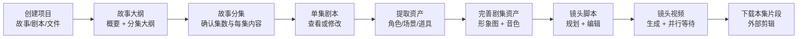
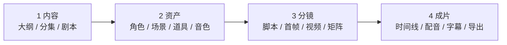

# Tago Movie 前端流程与工作台交互拆解

日期：2026-07-10
对象：Tago Movie、公开飞书 SOP、漫角当前项目生产台

## 0. 核心结论

Tago 好用的核心不是页面少，而是始终把用户限制在“当前集、当前阶段、当前主动作”三个上下文中。它把复杂能力藏在阶段内部，用强前置依赖和明确状态推进生产，用户不需要自己理解整条 AI 管线。

漫角当前的问题正好相反：同一套生产进度在全局阶段条、指标卡、生成控制台、工作台 Tabs、页面预检和底部跑道中重复出现；“设计总台、单镜头导演台、视频闭环”又把一个镜头的连续操作拆到了多个页面。应把当前 5 个工作台收敛为 4 个阶段，并让每个阶段只保留一个主动作。

## 1. 调研边界

- 竞品公开站点：https://tagomovie.bitaihub.com/
- 公开 SOP：个人 AI 漫剧从 0-1 全流程 SOP（新手可直接照做）
- SOP 最后编辑时间：2026-06-26
- 本次抓取时间：2026-07-10
- SOP 共还原 174 个内容区块，其中包含 33 张图片。
- 线上首页在 2026-07-10 展示了更新公告：Agent 2.0 镜头脚本、自由编辑剧本、20 集分集输出、画布模式下载、生成阻断原因提示等。说明 SOP 截图略早于当前版本，但核心信息架构仍一致。

## 2. Tago 的真实生产主链路

Tago 顶部把上述链路压缩成 5 个用户可理解的阶段：

1. 故事大纲
2. 故事分集
3. 剧本
4. 角色、场景与道具
5. 镜头视频

它没有把“AI 解析、提示词、模型路由、质量评估、任务队列”提升为主导航。这些是系统能力，不是用户任务。

## 3. 页面级拆解

| 页面/状态 | 用户目标 | 页面结构 | 唯一主动作 | 离开条件 |
|---|---|---|---|---|
| 首页创建区 | 提交故事源 | 大输入区 + 上传 + 比例/时长/风格 | 开始创作 | 基础参数完整 |
| 故事大纲 | 确认故事方向 | 顶部 5 步条 + 大纲正文 + 分集大纲 | 确认拆分/生成分集 | 大纲已生成 |
| 故事分集 | 确认各集内容 | 单集列表 + 当前集正文 | 生成本集剧本 | 当前集存在 |
| 剧本 | 阅读或修改单集剧本 | 当前集剧本文本 | 前往角色、场景与道具 | 剧本已生成 |
| 资产提取 | 从剧本识别生产资产 | 当前集角色/场景/道具列表 | 提取本集资产 | 提取任务完成 |
| 本剧资产库 | 完善跨集复用资产 | 模态总库，角色/场景/道具分组 | 生成全部图片/逐项确认 | 所需图片与角色音色齐全 |
| 分镜前检 | 确认资产齐备 | 资产缩略图 + 底部阻断状态 | 前往镜头视频工作台 | 角色、场景、道具、音色均满足 |
| 镜头视频工作台 | 编辑并生成单镜头 | 左资产、中脚本、右预览、底镜头轨 | 生成镜头视频 | 当前镜头参数合法 |
| 生成中 | 继续处理其他镜头 | 当前镜头状态 + 底部镜头轨 | 切换下一镜头 | 异步任务不阻塞编辑 |
| 预览/下载 | 检查结果并取回素材 | 右侧播放器 + 底部完成缩略图 | 下载全部 | 本集已有可下载片段 |

## 4. Tago 工作台的交互骨架

### 4.1 只有三层导航

1. 全局层：顶部“首页 / 项目中心 / 资产中心”。
2. 项目层：顶部 5 阶段进度。
3. 内容层：左侧当前剧集列表。

进入项目后没有再保留一个占宽的全局侧栏，也没有额外的“指标总览 + 生成控制台 + Tabs”组合。

### 4.2 空间职责固定

镜头视频阶段的布局在选择镜头、编辑、生成、等待、预览之间基本不变：

- 最左：剧集切换。
- 左侧：本集可引用角色、场景、道具。
- 中央：当前镜头脚本，时长、景别、画面、声音、备注、目的。
- 右侧：当前镜头视频预览。
- 底部：镜头轨道和每个镜头状态。
- 顶部右侧：模型、分辨率、重建镜头脚本、下载全部。

结果是在一个镜头上完成“选素材 → 改脚本 → 生成 → 等待 → 预览 → 重生”，不需要跳到另一个工作台找同一个镜头。

### 4.3 状态直接对应可执行动作

Tago 使用的状态不是泛化的“进行中/已完成”，而是生产语义：

- 可生成
- 已完成
- 未同步
- 被阻断
- 处理中

顶部状态计数可筛选，底部镜头卡承担定位。生成后当前页面不跳转，只把按钮改成生成中并更新镜头卡，用户可以继续处理其他镜头。

### 4.4 依赖在入口处阻断

Tago 不让用户进入下游后再排错：

- 角色、场景、道具未生成时，不能进入镜头视频。
- 角色未配置音色时，不能完成资产阶段。
- 时长不满足当前模型约束时，镜头顶部直接出现阻断横幅。
- 模型与分辨率在工作台顶部统一配置，修改后自动保存。

这比在多个页面分别显示“质量分、提示、任务状态、下一步建议”更有效。

### 4.5 高级编辑按需展开

资产默认以可扫视卡片展示。只有点击“编辑档案”才打开角色详细字段；生成、上传、复用已有形象分别是明确动作。用户不会一进入资产页就面对完整 Prompt 和所有模型参数。

## 5. Tago 为什么显得简单

1. 阶段命名使用创作者语言，不使用系统语言。
2. 当前集始终可见，跨集操作不会丢上下文。
3. 每个阶段只有一个“继续生产”的主按钮。
4. 上游依赖在进入下游前一次性检查。
5. 生成是异步状态变化，不是一次页面跳转。
6. 单镜头脚本、素材、视频和状态放在同一工作台。
7. 项目资产通过一个总库复用，但不会一直占据主页面。
8. 积分、模型、分辨率只在真正影响生成的位置出现。

## 6. 不应直接照搬的部分

Tago 当前 SOP 的终点是下载本集镜头片段，再进入剪映拼接。漫角已经具备 TTS、字幕、MP4 合成与导出任务能力，这部分应保留为差异化，不应退回到“只下载素材”。

另外，Tago 将角色、场景和道具集中在一个较大的模态框中，资产很多时会产生长滚动；漫角可以学习其阶段门禁和动作分组，但资产编辑仍应提供更强的筛选与固定详情面板。

## 7. 漫角当前前端的结构性问题

### 7.1 同一进度重复表达

当前项目生产页在实际内容之前依次出现：

1. 项目标题与返回/刷新/模型路由
2. 5 步阶段条
3. 4 张指标卡
4. 生成控制台
5. 工作台 Tabs
6. 当前工作台内部的状态摘要、预检和主按钮
7. 部分页面底部再次出现生产跑道

用户看到的是多个“总控台”，却不知道哪一个才是当前任务。

### 7.2 阶段语义不一致

同一页面内至少存在三套命名：

- 阶段条：剧本确认 / 角色定稿 / 分镜拆解 / 分镜图评估 / 视频合成导出
- Tabs：剧本解析 / 角色场景 / 设计总台 / 单镜头导演台 / 视频闭环
- 剧本页跑道：剧本可读 / 角色已抽取 / 场次就绪 / 分镜表生成 / 进入导演台

用户必须自己推断“设计总台”和“分镜图评估”是不是一件事。

### 7.3 一个镜头被拆成三个页面

- `DesignDeskBoard` 负责分镜设计总台。
- `CreatorImagesBoard` 负责单镜头首帧与编辑。
- `VideoBoard` 再次选择同一镜头生成/检查视频。

每次切换都要重新建立当前场次、镜头、资产和版本上下文。Tago 的关键优势正是把这些操作收在同一个镜头工作台。

### 7.4 主动作重复

生成控制台提供“下一步 + 积分确认”，工作台页头又提供生成按钮，剧本页右侧和底部还会再次提供生成/进入下一阶段的动作。重复 CTA 会让用户担心不同按钮是否产生不同结果。

### 7.5 工程层已经反映出页面失控

- `ProjectWorkbenchPage.tsx`：2491 行、约 12.8 万字符。
- `styles.css`：25438 行、约 56 万字符。
- `.project-workbench` 在样式文件中出现 1217 次。
- 可识别的阶段性 override/最终覆盖注释至少 46 处。

这不是单纯的视觉问题。大量后置覆盖让一个局部改动可能影响多个工作台，也导致页面只能继续追加 CSS 来修复前一次追加。

代码定位：

- 五个旧工作台类型：`apps/web/src/pages/ProjectWorkbenchPage.tsx:61`
- 阶段条、指标卡、生成控制台、Tabs 连续堆叠：`apps/web/src/pages/ProjectWorkbenchPage.tsx:248`
- 剧本页再次出现底部生产跑道：`apps/web/src/pages/ProjectWorkbenchPage.tsx:502`
- 设计总台与单镜头分别实现：`apps/web/src/pages/ProjectWorkbenchPage.tsx:861`、`:1300`
- 视频闭环再次承担镜头选择与预览：`apps/web/src/pages/ProjectWorkbenchPage.tsx:1609`
- 多轮最终样式覆盖的代表位置：`apps/web/src/styles.css:11341`、`:13787`、`:18249`、`:18694`、`:19624`

## 8. 推荐的新信息架构：4 个阶段

### 1 内容

- 把当前“剧本解析”改成内容阶段。
- 内部用紧凑的分段控制：大纲 / 分集 / 剧本。
- 左侧始终为剧集；中央为当前内容；右侧只显示本阶段检查和一个主动作。
- 不再显示六段故事结构、五张状态卡、预检清单和底部跑道四套摘要，保留一套即可。

### 2 资产

- 合并角色、场景、道具和音色前置检查。
- 默认显示资产清单与完成状态；详细档案、Prompt、seed、模型参数进入详情抽屉。
- 主动作根据状态变化：提取资产 → 生成缺失资产 → 完成资产并进入分镜。

### 3 分镜

- 合并当前“设计总台”和“单镜头导演台”。
- 单镜头模式布局：左资产、中脚本、右图片/视频预览、底镜头轨。
- 矩阵模式作为同一页面的视图切换，不再是独立阶段。
- 当前镜头内完成：字段编辑、首帧生成、候选版本、视频生成、预览、重生。
- 质量评估作为筛选和状态，不单独占据总控卡片。

### 4 成片

- 只处理跨镜头组装：时间线、TTS、字幕、音效、封面、MP4。
- 单镜头视频生成从当前 `VideoBoard` 移回分镜阶段。
- 保留漫角已有的成片闭环，这是相对 Tago 的产品优势。

## 9. 推荐的统一项目壳

项目页只保留以下四层：

1. 顶栏：返回、项目名、当前集、保存状态、任务/积分、项目设置。
2. 阶段条：内容 / 资产 / 分镜 / 成片。
3. 左侧剧集栏：集数、完成度、异常数。
4. 当前阶段工作区。

删除独立指标卡行和常驻生成控制台。任务进度收进顶栏任务入口；模型、比例、分辨率收进项目设置或当前生成按钮的确认浮层。

## 10. 当前模块的处理建议

| 当前模块 | 处理 | 新位置 |
|---|---|---|
| `workflow-rail` | 保留并重命名为 4 阶段 | 项目顶栏下方 |
| `metric-grid` | 删除常驻展示 | 项目概览/顶栏摘要 |
| `production-console` | 拆除 | 主动作、成本确认、任务进度分别回到发生位置 |
| `ScriptBoard` | 重构 | 内容阶段 |
| `CreatorCharacterBoard` | 保留核心能力并简化 | 资产阶段 |
| `DesignDeskBoard` | 与单镜头合并 | 分镜阶段的矩阵模式 |
| `CreatorImagesBoard` | 成为主工作区 | 分镜阶段的单镜头模式 |
| `VideoBoard` 的单镜头部分 | 上移 | 分镜阶段右侧预览 |
| `VideoBoard` 的时间线/导出部分 | 保留 | 成片阶段 |
| 质量报告/反馈 | 下沉 | Inspector、筛选、任务详情 |
| 模型路由 | 下沉 | 项目设置或生成确认浮层 |

## 11. 必须统一的状态模型

阶段状态统一为：`未开始 / 可继续 / 处理中 / 被阻断 / 已完成`。

镜头状态统一为：`缺脚本 / 缺首帧 / 可生成视频 / 视频生成中 / 视频完成 / 需重做`。

主按钮必须由状态推导，不允许同屏出现多个等价动作。例如：

- 内容未生成：生成大纲
- 大纲完成：生成分集
- 分集完成：生成本集剧本
- 剧本完成：提取资产
- 资产不齐：生成缺失资产
- 资产齐全：进入分镜
- 镜头缺首帧：生成首帧
- 首帧完成：生成镜头视频
- 全镜头完成：进入成片

## 12. 实施顺序

### P0：先减层，不改后端

1. 建立新的 4 阶段项目壳。
2. 删除指标卡与常驻生成控制台。
3. 统一三套阶段命名和状态选择器。
4. 将模型路由移入项目设置。
5. 合并“设计总台”和“单镜头导演台”的入口。
6. 使用现有 API 完成状态驱动，不新增复杂后端对象。

### P1：拆组件和样式边界

1. 将 2491 行页面拆为 `ProjectStudioShell`、`ContentStage`、`AssetsStage`、`ShotsStage`、`AssemblyStage`。
2. 每个阶段拥有独立样式入口，停止在 `styles.css` 末尾继续追加最终覆盖。
3. 将集 ID、镜头 ID、视图模式写入 URL，刷新后恢复上下文。
4. 抽出统一 `StageGate`、`PrimaryAction`、`TaskStatus`、`ShotStrip`。

### P2：补齐连续操作

1. 在分镜阶段同屏完成首帧和视频生成。
2. 支持生成中切换并继续处理其他镜头。
3. 统一镜头筛选：可生成、处理中、被阻断、已完成、需重做。
4. 成片阶段只接收已完成镜头，缺失项在时间线显示断点。

## 13. 验收标准

- 从打开项目到编辑当前内容，首屏不超过 2 层控制区。
- 项目内主导航只出现一次，阶段命名全站一致。
- 每个阶段最多一个高强调主按钮。
- 用户切换集、镜头、矩阵视图后不会丢失当前上下文。
- 一个镜头的脚本、首帧、视频和状态可在同一工作台完成。
- 生成中可以切换并继续处理其他镜头。
- 所有阻断都说明“缺什么、去哪里补、补完后会发生什么”。
- 成片阶段不再承担单镜头生成，只负责跨镜头装配与导出。
- 新样式不再依赖文件末尾的全局 override 才能正确显示。

## 14. 证据截图索引

本次从公开 SOP 提取的 17 张关键截图位于：`output/benchmark-tago/`

- `03-project-settings.png`：项目创建参数
- `04-outline-result.png`：5 阶段顶栏与大纲结果
- `07-asset-extract-result.png`：当前集资产
- `08-asset-library.png`：项目资产总库
- `09-character-editor.png`：按需展开角色档案
- `10-character-result.png`：形象与音色状态
- `11-storyboard-preflight.png`：进入镜头工作台前置门禁
- `12-storyboard-workbench.png`：镜头视频工作台结构
- `13-shot-editor.png`：镜头脚本编辑
- `14-generate-video.png`：单镜头生成中
- `15-video-queue.png`：多镜头并行状态
- `16-video-preview.png`：右侧预览与底部镜头轨
- `17-download.png`：本集片段批量下载
